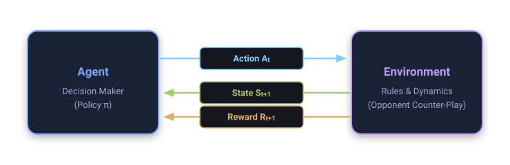

::: {.callout-note appearance="simple"}
## In brief
Unlike supervised learning, which relies on instructional corrective feedback from an external oracle, reinforcement learning systems discover optimal decision policies purely through active interaction, trial, error, and evaluative reward.
This inaugural episode introduces the foundations of tabular value learning using the classic game of noughts and crosses (tic-tac-toe): formalising how delayed temporal credit cascades backwards through state-value estimates and how exploration mitigates sub-optimal policy collapse.

### Episode Metadata
- **Game:** Tic-tac-toe (Noughts and Crosses)
- **Source:** Sutton & Barto, *Reinforcement Learning: An Introduction* (2nd ed.), Chapter 1, §1.1–1.7 [@sutton2018reinforcement]
- **Reading Time:** Story ~5 min · Idea ~15 min · Maths & Code ~35 min
- **Series Index:** [RL from First Principles](../../index.qmd#rl-first-principles)
:::

::: {.panel-tabset group="depth"}

## Story

Rain taps against the kitchen windowpane.
Ada is six years old, and she is thoroughly bored.
Grandpa Leo sets down his mug of Earl Grey tea, picks up an ink pen, and draws a crisp grid of nine squares on a sheet of scrap paper.
Biscuit, his scruffy terrier, curls up quietly beneath the wooden table.

"A game of noughts and crosses," Grandpa Leo announces with a twinkle in his eye.
"You shall play crosses. I shall play noughts."

Ada grips her pencil tightly.
"How do I win, Grandpa?"

Grandpa Leo leans back in his wicker chair and smiles.
"I am not going to give you instructions or tell you where to move. We shall simply play, and you will discover it yourself."

{#fig-story-tictactoe fig-align="center" width="70%"}

Ada loses her very first game within four turns.
She loses the second game as well.
In the third encounter, however, she places her cross squarely in the centre square almost by accident.
Suddenly Grandpa Leo pauses, studies the board carefully, and scratches his chin.
Two moves later, Ada completes a diagonal line of three crosses.
She leaps up from her chair and cheers!

Ada runs over to the dresser, grabs a small blue notebook, and flips to a clean page.
Every time a match concludes, she retraces the sequence of boards that unfolded along the way.
Whenever a board layout leads directly to victory, she sketches a beaming happy face beside it.
Whenever a layout leads to defeat, she sketches a frown.
When a match ends in a stalemate, she sketches a neutral, flat line.

After forty games across the afternoon, something magical begins to happen.
Before placing her pencil onto paper, Ada glances across the empty squares and can almost feel which moves lead toward winning positions.
She naturally selects the move that transitions the board into one carrying a happy face.

Occasionally, however, she deliberately tests an unusual move that she has never tried before.
"Why did you place your cross in that odd corner, Ada?" laughs Grandpa Leo.
"That seems like an eccentric move!"

"I am exploring," Ada replies proudly.
"Perhaps that square is secretly wonderful!"

Most of the time, the eccentric move leads nowhere special.
Yet once in a while, it reveals an ingenious trap that Grandpa Leo cannot block, earning a fresh smiley face in her little notebook.

By teatime, Ada and Grandpa draw every single contest.
Nobody ever handed Ada a handbook or dictated a fixed set of rules.
She acquired mastery purely through interaction, rewards, and keen observation.

::: {.callout-tip}
## What Would You Do?
If nobody ever explains the optimal strategy to you, how can you still systematically improve your skill at a game?
:::

---

## Idea

### Learning from Evaluative Feedback

The fundamental distinction separating reinforcement learning from classical supervised learning lies in the nature of feedback:

1. **Supervised Learning (Instructional Feedback):** An external oracle provides ground-truth supervisory labels delineating the exact corrective action required in each scenario.
2. **Reinforcement Learning (Evaluative Feedback):** The environment supplies a scalar numerical reward evaluating how favourable the outcome was, without ever indicating whether an alternative, untaken action was superior.

{#fig-rl-interaction-loop fig-align="center" width="85%"}


### Why Supervision Fails Where Reinforcement Succeeds

Why can we not simply formulate game-playing and sequential control as standard supervised classification?
Supervised learning requires an exhaustive training corpus of state-action pairs $(s, a^*)$ labelled with optimal decisions.
In sequential domains, this paradigm suffers from three critical failure modes:

1. **The Oracle Paradox:**
   For complex sequential decision problems, no omniscient human or computational oracle exists to provide optimal labels across the combinatorial explosion of states.
   If an expert already possessed the optimal policy for every board state, programming the system directly would be trivial, obviating the need for machine learning.
2. **Imitation Ceiling and Sub-optimal Demonstration:**
   A supervised model trained on behavioural cloning can never surpass the skill of the teacher who supplied the training data.
   If Grandpa Leo plays with systematic flaws or cognitive blind spots, a supervised network dutifully replicates those blunders.
   Reinforcement learning, conversely, circumvents teacher bias: by learning directly from outcomes ($+1$ for win, $-1$ for loss), an agent discovers creative strategies unthought of by its creators.
3. **Distributional Covariate Shift (Compounding Errors):**
   In supervised learning, training assumes independent and identically distributed (i.i.d.) data.
   In sequential interaction, however, an agent's current action dictates the subsequent state distribution.
   If a supervised agent makes a minor prediction error, it lands in an unfamiliar state outside its training distribution.
   Without training data in that region, errors compound rapidly along the trajectory, leading to catastrophic failure.
   Reinforcement learning is inherently active and closed-loop: the agent experiences the causal consequences of its own mistakes, learning corrective recoveries directly from the environment.

### Credit Assignment and Value Propagation

When playing a game, reward signals are typically delayed until termination.
How does an agent determine which early opening move was genuinely responsible for a victory attained twenty turns later?
This challenge is formalised as the **temporal credit assignment problem**.

In our tabular formulation, the agent maintains an internal lookup table assigning an estimated **value** $V(s) \in [0, 1]$ to each board state $s$, representing the long-term probability of victory from that state.
Learning operates via backward propagation:

- States containing three crosses in a row are terminal winning states: $V(s) = 1$.
- States containing three noughts in a row are terminal losing states: $V(s) = 0$.
- Stalemate boards have terminal value $V(s) = 0.5$.
- All intermediate states are initialised optimistically to $V(s) = 0.5$.

As games unfold, probability values gradually cascade backwards from terminal outcomes into earlier configurations:

$$V(S_t) \leftarrow V(S_t) + \alpha \big[ V(S_{t+1}) - V(S_t) \big]$$

where $\alpha \in (0, 1]$ denotes the step-size learning rate.

### The Exploration-Exploitation Dilemma

At every decision point, an agent confronts a core trade-off:

- **Exploitation:** Select the move leading to the state $S_{t+1}$ with the highest existing estimated value $V(S_{t+1})$ to maximise current win rate.
- **Exploration:** Select an alternative move at random with probability $\epsilon$ to sample uncharted state trajectories and refine inaccurate estimates.

If an agent acts purely greedily ($\epsilon = 0$), it risks latching onto a sub-optimal heuristic formed through early stochastic luck.
Conversely, if an agent explores excessively, it sacrifices performance by repeatedly committing catastrophic blunders.

::: {.callout-warning}
## Common Misconception
**Misconception:** "Reinforcement learning is merely unstructured trial and error at random."
**Reality:** While random sampling initiates exploration, the errors are systematically captured by the value function.
Subsequent decisions are biased toward high-value basins, converting random variance into guided, goal-directed improvement.
:::

---

## Maths & Code

### Mathematical Formalisation

#### Foundational Elements of Reinforcement Learning

Following Sutton and Barto [-@sutton2018reinforcement, §1.3], a reinforcement learning system is characterised by four integral sub-elements:

1. **Policy ($\pi$):** A mapping $\pi: \mathcal{S} \times \mathcal{A} \to [0, 1]$, where $\pi(a \mid s) \triangleq \mathbb{P}(A_t = a \mid S_t = s)$ delineates the agent's behavioural disposition across valid actions.
2. **Reward Signal ($R_t \in \mathbb{R}$):** An immediate scalar evaluative feedback transmitted by the environment at each discrete transition, defining the operational objective.
3. **Value Function ($V(s)$ vs $Q(s, a)$):** Whereas reward specifies immediate desirability, the state-value function $V(s)$ quantifies the expected cumulative return over the long-term horizon, taking into account the states likely to follow.
4. **Model of the Environment:** An internal representation of transition dynamics. In tic-tac-toe, the agent leverages a simple 1-step lookahead model of the game rules to evaluate candidate moves directly via state values $V(s')$, circumventing the requirement for model-free action-value functions $Q(s, a)$.

#### The Markov Decision Process Formalism

We model the learning agent under the formalism of a discrete-time Markov Decision Process (MDP) defined by the 5-tuple $(\mathcal{S}, \mathcal{A}, \mathcal{P}, \mathcal{R}, \gamma)$:

- **State Space ($\mathcal{S}$):** The finite set of valid 9-cell board configurations, with $S_t \in \mathcal{S}$ representing the board state at turn $t$.
- **Action Space ($\mathcal{A}(s)$):** The state-dependent set of legal placements available in unoccupied squares.
- **Transition Dynamics ($\mathcal{P}$):** The transition probability kernel $\mathcal{P}(s' \mid s, a) \triangleq \mathbb{P}(S_{t+1} = s' \mid S_t = s, A_t = a)$. In a two-player game, a single environment transition folds the agent's placement $A_t$ together with the opponent's subsequent counter-action $A_{\text{opp}}$, preserving the Markov property from the agent's perspective against a stationary opponent.
- **Reward Function ($\mathcal{R}$):** Immediate scalar feedback $R_{t+1} = \mathcal{R}(S_t, A_t, S_{t+1})$. Intermediate step rewards are zero, with evaluative payoffs allocated at episode termination $T$:
  $$R_T = \begin{cases} +1 & \text{if agent wins} \\ 0 & \text{if draw or loss} \end{cases}$$
- **Discount Factor ($\gamma$):** The parameter $\gamma \in [0, 1]$ weighting future vs immediate returns. Because tic-tac-toe is an episodic game with guaranteed finite termination ($T \le 9$), we set $\gamma = 1$ (undiscounted episodic return).

#### Trajectory, Return, and State Value

An episode generates a finite trajectory $\tau = (S_0, A_0, R_1, S_1, A_1, \dots, R_T, S_T)$.
The return $G_t$ denotes the cumulative discounted reward accumulated from time step $t$:

$$G_t \triangleq \sum_{k=0}^{T-t-1} \gamma^k R_{t+k+1}$$

With $\gamma = 1$ and zero intermediate rewards, $G_t = R_T$.
The state-value function $V^\pi(s)$ under policy $\pi$ represents the expected return contingent upon starting from state $s$:

$$V^\pi(s) \triangleq \mathbb{E}_\pi \left[ G_t \mid S_t = s \right] = \mathbb{P}(\text{Win} \mid S_t = s, \pi)$$

#### Why Supervised Loss Fails: Empirical Risk vs Bellman Consistency

In supervised learning, an agent minimises empirical cross-entropy loss over a static dataset of teacher transitions $\mathcal{D} = \{(s_i, a_i^*)\}_{i=1}^N$:

$$\min_\theta \mathbb{E}_{(s, a^*) \sim \mathcal{D}} \left[ -\ln \pi_\theta(a^* \mid s) \right]$$

This objective treats transitions as independent and identically distributed.
Under sequential rollouts, however, policy deviations induce covariate shift: the true visitation distribution $d^{\pi_\theta}(s)$ diverges from the demonstration distribution $d^{\pi^*}(s)$, causing error growth proportional to $\mathcal{O}(\epsilon T^2)$ over horizon $T$ (the compounding error bound of behavioural cloning).

Reinforcement learning replaces empirical label fitting with **Bellman consistency**.
Rather than matching arbitrary teacher actions, the objective aligns state evaluations with realized environmental returns:

$$\min_V \mathbb{E}_{s \sim d^\pi} \left[ \Big( V(s) - \mathbb{E}\left[ R_{t+1} + \gamma V(S_{t+1}) \mid S_t = s \right] \Big)^2 \right]$$

Because the state distribution $d^\pi$ is generated by the agent's own interaction, any trajectory diversion automatically populates the value table with corrective feedback, ensuring stability and surpassing human demonstration bounds.

#### The Temporal-Difference Update Rule

Following each non-exploratory state transition $S_t \to S_{t+1}$ (accounting for the opponent's subsequent counter-move), the value estimate is updated via:

$$V(S_t) \leftarrow V(S_t) + \alpha \Big( V(S_{t+1}) - V(S_t) \Big)$$

where:

- $V(S_t)$ is the current value estimate of state $S_t$.
- $V(S_{t+1})$ serves as the **bootstrapping target**—the foundational principle of updating an existing evaluation estimate from subsequent estimates rather than awaiting the empirical terminal return $G_t$ at episode conclusion.
- $\delta_t \triangleq R_{t+1} + \gamma V(S_{t+1}) - V(S_t) = V(S_{t+1}) - V(S_t)$ is the temporal-difference (TD) error (recalling $R_{t+1} = 0$ for non-terminal transitions and $\gamma = 1$).
- $\alpha \in (0, 1]$ is the step-size parameter governing the learning rate.

If $\alpha$ is reduced gradually satisfying the Robbins-Monro conditions $\sum_{k=1}^\infty \alpha_k = \infty$ and $\sum_{k=1}^\infty \alpha_k^2 < \infty$, $V(s)$ converges asymptotically to the true win probabilities against any stationary opponent [@sutton2018reinforcement].

::: {.callout-important}
## Why Are Exploratory Moves Excluded from Updates?
In the classic formulation of Sutton and Barto §1.5, when the agent takes an exploratory move, the prior state $S_t$ is not updated using the value of the exploratory successor.
Learning from exploratory actions would bias the value function toward reflecting the consequences of irrational exploratory blunders rather than the value of states under greedy execution.
This serves as an early pedagogical precursor to off-policy Q-learning [@watkins1992q].
:::

### Algorithmic Specification

```text
Algorithm: Tabular TD(0) Value Learning for Tic-Tac-Toe
Initialize V(s) = 0.5 for all non-terminal states s in S
Initialize V(s) = 1.0 for winning terminal states
Initialize V(s) = 0.0 for losing terminal states
Initialize V(s) = 0.5 for draw terminal states

For each training episode:
    s = Initial empty board state
    trajectory = [s]
    While s is not terminal:
        With probability epsilon:
            a = UniformRandomChoice(legal_actions(s))
            exploratory = True
        Else:
            a = argmax_{a' in legal_actions(s)} V(successor(s, a'))
            exploratory = False
        
        Execute a, observe intermediate board s_mid
        If s_mid is terminal:
            s_next = s_mid
        Else:
            Opponent chooses move a_opp
            s_next = successor(s_mid, a_opp)
        
        If not exploratory:
            V(s) <- V(s) + alpha * [V(s_next) - V(s)]
        
        s = s_next
```

### Complete NumPy Implementation

Below is a self-contained, reproducible Python implementation of the tabular value iteration agent playing against both random and heuristic opponents:

```python
import numpy as np

class TicTacToe:
    def __init__(self):
        self.board = np.zeros(9, dtype=int)
        
    def reset(self):
        self.board.fill(0)
        return self.get_state()

    def get_state(self):
        return tuple(self.board)

    def legal_moves(self):
        return np.where(self.board == 0)[0]

    def make_move(self, action, player):
        self.board[action] = player

    def check_winner(self):
        wins = [
            (0, 1, 2), (3, 4, 5), (6, 7, 8),
            (0, 3, 6), (1, 4, 7), (2, 5, 8),
            (0, 4, 8), (2, 4, 6)
        ]
        for a, b, c in wins:
            if self.board[a] != 0 and self.board[a] == self.board[b] == self.board[c]:
                return self.board[a]
        if len(self.legal_moves()) == 0:
            return 0  # Draw
        return None  # Ongoing


class TabularRLAgent:
    def __init__(self, alpha=0.1, epsilon=0.1, seed=42):
        self.alpha = alpha
        self.epsilon = epsilon
        self.values = {}
        self.rng = np.random.default_rng(seed)

    def get_value(self, state, winner=None):
        if winner == 1:
            return 1.0
        elif winner == -1:
            return 0.0
        elif winner == 0:
            return 0.5
        if state not in self.values:
            self.values[state] = 0.5
        return self.values[state]

    def select_action(self, env, explore=True):
        moves = env.legal_moves()
        if explore and self.rng.random() < self.epsilon:
            return self.rng.choice(moves), True

        best_val = -np.inf
        best_moves = []
        for m in moves:
            env.make_move(m, 1)
            winner = env.check_winner()
            val = self.get_value(env.get_state(), winner)
            env.make_move(m, 0)

            if val > best_val:
                best_val = val
                best_moves = [m]
            elif np.isclose(val, best_val):
                best_moves.append(m)

        action = self.rng.choice(best_moves)
        return action, False

    def update(self, s, s_prime):
        v_s = self.get_value(s)
        v_prime = self.get_value(s_prime)
        self.values[s] = v_s + self.alpha * (v_prime - v_s)


def train(episodes=10_000, alpha=0.1, epsilon=0.1, seed=42):
    agent = TabularRLAgent(alpha=alpha, epsilon=epsilon, seed=seed)
    rng = np.random.default_rng(seed)
    history = []

    for ep in range(episodes):
        env = TicTacToe()
        s = env.reset()
        done = False

        while not done:
            action, explored = agent.select_action(env, explore=True)
            env.make_move(action, 1)
            winner = env.check_winner()

            if winner is not None:
                if not explored:
                    agent.update(s, env.get_state())
                history.append(winner)
                break

            # Opponent turn: Random policy
            opp_moves = env.legal_moves()
            opp_action = rng.choice(opp_moves)
            env.make_move(opp_action, -1)
            winner = env.check_winner()

            s_next = env.get_state()
            if not explored:
                agent.update(s, s_next)

            if winner is not None:
                history.append(winner)
                break
            s = s_next

    return agent, np.array(history)
```

### Empirical Evaluation

Evaluating the agent over 10,000 games reveals monotonic asymptotic improvement.
In early iterations, the random opponent scores occasional victories.
Within 2,000 episodes, the agent's win rate ascends past 90%, with losses completely extinguished as credit diffuses back to the root opening state:

```python
agent, hist = train(episodes=10_000, alpha=0.1, epsilon=0.1)

# Windowed win-rate calculation
window = 500
wins = np.convolve(hist == 1, np.ones(window)/window, mode='valid')
draws = np.convolve(hist == 0, np.ones(window)/window, mode='valid')
losses = np.convolve(hist == -1, np.ones(window)/window, mode='valid')

print(f"Final 1,000 Games Performance:")
print(f"  Win Rate:  {np.mean(hist[-1000:] == 1) * 100:.1f}%")
print(f"  Draw Rate: {np.mean(hist[-1000:] == 0) * 100:.1f}%")
print(f"  Loss Rate: {np.mean(hist[-1000:] == -1) * 100:.1f}%")
```

### Analytical Exercises

1. **Exercise 1.1: Self-Play Dynamics.**
   If both players utilise value iteration simultaneously, how does non-stationarity manifest?
   Will the system converge to an unexploitable minimax equilibrium, or can cycling occur?
2. **Exercise 1.2: State-Space Reduction via Symmetries.**
   The board exhibits the dihedral symmetry group $D_4$ of order 8 (rotations and reflections).
   By quotienting the state space $\mathcal{S} / D_4$, by what factor is the tabular parameter size compressed, and how does this accelerate convergence?
3. **Exercise 1.3: Greedy Exploitation Pathology.**
   If $\epsilon = 0$ throughout training against an imperfect opponent, construct a concrete counterexample where the agent acquires a policy that wins reliably yet remains vulnerable to an unobserved defensive response.
4. **Exercise 1.4: Off-Policy Bootstrapping.**
   Suppose the agent updates $V(S_t)$ from $S_{t+1}$ even when $A_t$ was selected exploratively.
   Formally demonstrate how this contaminates value estimates with exploratory regret.

:::

---

## Game Theory Corner

From an game-theoretic standpoint, tic-tac-toe is a finite, extensive-form, two-player zero-sum game with perfect information [@vonneumann1944theory].
By Zermelo's theorem, there exists a unique game-theoretic value under backwards induction: with optimal backward play, the game is a deterministic draw.

Arthur Samuel's seminal 1959 checkers player [@samuel1959some] demonstrated that learning state values via linear parameter updates can approximate minimax tree search without exhaustive combinatorial expansion.
When our tabular agent plays against an unvarying suboptimal adversary, it does not seek the game-theoretic minimax equilibrium; rather, it actively exploits the opponent's systematic idiosyncrasies to maximise empirical payoff.

---

## Glossary

- **Agent:** The active entity that observes state, computes policy, and executes actions.
- **Environment:** Everything external to the agent, specifying the transition dynamics and reward responses.
- **State ($S_t$):** The complete informational representation of the current configuration.
- **Value Function ($V(s)$):** The expected cumulative discounted future reward conditional on starting in state $s$.
- **Temporal-Difference Error ($\delta_t$):** The discrepancy between successive state value estimates: $\delta_t = V(S_{t+1}) - V(S_t)$.
- **Exploration vs Exploitation:** The essential trade-off between trying novel actions to acquire information versus choosing known high-reward actions.

---

## Next in the Series

In **Season 1, Episode 01: Which Candy Machine?**, we isolate the exploration-exploitation dilemma from delayed state transitions through the classic $k$-armed bandit framework.

- **Next Episode:** *01. Which Candy Machine? (Multi-Armed Bandits)* (coming soon)

## References {.unnumbered}

::: {#refs}
:::
