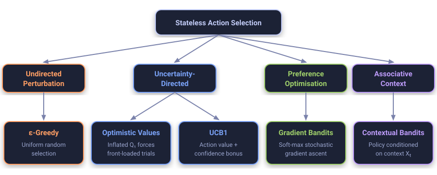

::: {.callout-note appearance="simple"}
## In brief
In the preceding episode, we established how sample-average updates and $\varepsilon$-greedy action selection navigate the tension between empirical exploitation and stochastic exploration.
Nonetheless, selecting actions uniformly at random during exploratory intervals incurs linear regret because the agent samples known inferior actions with equal likelihood.
This episode formalises **uncertainty-directed exploration** and **preference-based gradient learning**.
Specifically, we delineate optimistic initialisation, derive the Upper Confidence Bound (UCB1) algorithm to achieve logarithmic regret, substantiate soft-max policy gradient updates via stochastic gradient ascent, and introduce associative search as the conceptual bridge toward full Markov Decision Processes [@sutton2018reinforcement; @auer2002finite; @lai1985asymptotically].

### Episode Metadata
- **Game:** Candy machines with a twist
- **Source:** Sutton & Barto, *Reinforcement Learning: An Introduction* (2nd ed.), Chapter 2, §2.6–2.10 [@sutton2018reinforcement]
- **Series Index:** [RL from First Principles](../../index.qmd#rl-first-principles)
:::

::: {.panel-tabset group="depth"}

## Story

The following weekend, Ada and Grandpa Leo return to the autumn fairground.
The candy booth has expanded substantially: an extended row of colourful vintage dispensers now stretches across the pavilion.

"Too many to check one by one with a handful of tokens," Ada observes, surveying the line with dismay.

Grandpa Leo retrieves a piece of chalk and draws a conspicuous question mark over each dispenser that Ada has barely touched.
"A dispenser you know very little about might harbour an extraordinary payout," he notes with a smile.
"To discover its potential, we must provide those unfamiliar levers with a fair appraisal."

Ada conceives a methodical heuristic.
She begins her trial by pretending every single dispenser is exceptionally generous, recording an initial tally of ten sweets beside every machine on her napkin.
Each time a machine dispenses merely one or two sweets, the disappointing outcome pulls its running average downwards.
Consequently, this initial optimism compels her to test every machine at least once or twice before settling upon an apparent favourite.

Furthermore, Ada refines her exploratory strategy.
Instead of pulling levers entirely at random when curious, she prioritises the dispensers enveloped by the greatest uncertainty.
A dispenser pulled forty times has yielded its secrets; its empirical performance is corroborated with high confidence.
Conversely, a dispenser pulled only once remains an enigma whose true distribution might easily eclipse the current front-runner.

"Curious," Grandpa Leo observes, admiring her napkin, "yet genuinely clever in where you direct that curiosity."

By late afternoon, the booth keeper introduces a final twist.
Each dispenser is equipped with an overhead indicator lamp that alternates between red and blue.
When the illumination is red, the dispensers on the left flank prove consistently superior; when blue, the rightmost bank yields the greatest bounty.

Ada ceases asking "Which dispenser is universally superior?"
Instead, she conditions her decision upon the immediate context: "Which dispenser manifests the highest payout when the lamp glows this colour?"
Within moments, she glances at the context lamp and navigates directly to the optimal machine.

::: {.callout-tip}
## What Would You Do?
Is it more advantageous to explore options entirely at random, or to deliberately allocate exploratory trials to the options about which you possess the least empirical evidence?
:::

---

## Idea

### Moving Beyond Undirected Exploration

While an $\varepsilon$-greedy policy guarantees asymptotic convergence to true action values by perturbing decisions uniformly with probability $\varepsilon$, its exploratory mechanism is fundamentally undirected.
The agent expends valuable trials pulling alternatives regardless of whether an alternative has been tested a thousand times or never touched.

To mitigate this inefficiency, we employ two distinct paradigms:

1. **Optimism in the Face of Uncertainty:** By instilling an initial prior belief that all actions yield maximal reward ($Q_1(a) \gg q_*(a)$), the agent is systematically driven by empirical disappointment to sample every untried action during early iterations.
2. **Confidence-Directed Selection (UCB):** By augmenting each value estimate with an uncertainty bonus proportional to $\sqrt{\ln t / N_t(a)}$, action selection leverages the upper bound of a statistical confidence interval. An action is selected either because its empirical payoff estimate is superior or because its estimate remains heavily unverified.

{#fig-exploration-paradigms fig-align="center" width="95%"}

### What to Notice
- **Optimism Fades Naturally:** Optimistic initial values drive heavy exploration early on, but the drive is temporary: once the estimates fall to realistic levels it vanishes, so optimism alone cannot track machines whose payouts drift.
- **Logarithmic Regret:** Under UCB1, the expected number of pulls of any suboptimal action $a$ grows only as $\mathcal{O}(\ln T / \Delta_a^2)$, so its contribution to regret is $\mathcal{O}(\ln T / \Delta_a)$, in contrast to the $\mathcal{O}(T)$ linear regret incurred by constant $\varepsilon$-greedy policies.
- **Preferences vs Absolute Values:** Gradient bandits do not estimate expected returns directly; instead, they optimise a relative preference manifold invariant to global reward translation when an empirical baseline is subtracted.

### Try It: Four Ways to Explore

All four strategies on the 10-armed testbed, simulated live in your browser and averaged over many independent problems.
Defaults follow Sutton & Barto: optimistic greedy uses $Q_1 = 5$, $\varepsilon = 0$ and $\alpha = 0.1$ (Figure 2.3), UCB uses $c = 2$ (Figure 2.4).
Shift every true value up by $+4$ and untick the baseline to reproduce Figure 2.5; switch on drift to watch optimism fade.

```{ojs}
//| echo: false
import {makeRng, argmaxRandom, runTestbed, toRows, observeTheme, palette} from "../../assets/ojs/rl.js"
theme = Generators.observe(observeTheme)
pal = palette(theme)
```

::: {.rl-widget}

```{ojs}
//| echo: false
viewof explore = Inputs.form({
  runs: Inputs.range([50, 1000], {step: 50, value: 200, label: "Problems averaged"}),
  epsilon: Inputs.range([0, 0.3], {step: 0.01, value: 0.1, label: "ε (ε-greedy)"}),
  q0: Inputs.range([0, 10], {step: 0.5, value: 5, label: "Q₁ (optimistic)"}),
  c: Inputs.range([0, 4], {step: 0.1, value: 2, label: "c (UCB)"}),
  alpha: Inputs.range([0.01, 0.5], {step: 0.01, value: 0.1, label: "α (gradient)"}),
  baseline: Inputs.toggle({label: "Gradient baseline", value: true}),
  shift: Inputs.toggle({label: "Shift q* by +4", value: false}),
  drift: Inputs.toggle({label: "Drifting machines", value: false})
})
```

```{ojs}
//| echo: false
exploreNames = ["ε-greedy", "Optimistic greedy", "UCB", "Gradient bandit"]
exploreRows = {
  const common = {
    runs: explore.runs, steps: explore.drift ? 3000 : 1000, seed: 7,
    nonstationary: explore.drift, offset: explore.shift ? 4 : 0
  };
  const series = [
    {name: exploreNames[0], ...runTestbed({...common, epsilon: explore.epsilon})},
    {name: exploreNames[1], ...runTestbed({...common, epsilon: 0, alpha: 0.1, q0: explore.q0 + common.offset})},
    {name: exploreNames[2], ...runTestbed({...common, method: "ucb", c: explore.c})},
    {name: exploreNames[3], ...runTestbed({...common, method: "gradient", alpha: explore.alpha, baseline: explore.baseline})}
  ];
  return toRows(series, common.steps / 200);
}
```

```{ojs}
//| echo: false
explorePlot = (y, label, domain) => Plot.plot({
  width: Math.min(width, 760),
  height: 250,
  marginLeft: 50,
  style: {background: "transparent"},
  x: {label: "Step"},
  y: {label, grid: true, domain},
  color: {domain: exploreNames, range: [pal.orange, pal.magenta, pal.blue, pal.green], legend: true},
  marks: [Plot.lineY(exploreRows, {x: "step", y, stroke: "series", strokeWidth: 1.5})]
})
explorePlot("optimal", "% optimal action", [0, 100])
```

```{ojs}
//| echo: false
explorePlot("reward", "Average reward", undefined)
```

<p class="rl-note">The optimistic start is set relative to the shifted values, so Q₁ always means "this far above the average arm".</p>

:::

::: {.callout-warning}
## Common Misconception
**Misconception:** "Exploratory steps are wasted reward."
**Reality:** An exploratory pull costs reward now but buys information: it narrows the uncertainty about an action, and that knowledge pays off on every later decision. Over a long horizon, directed exploration such as UCB gives up far less reward than either never exploring or exploring at random.
:::

---

## Maths & Code

### Optimistic Initial Values (§2.6)

Let the initial action-value estimates be set to an optimistic bound:

$$Q_1(a) = +\bar{r} \quad \forall a \in \{1, \dots, k\}, \quad \text{where } \bar{r} \gg \max_{a} q_*(a).$$

Under a standard greedy selection policy $A_t = \arg\max_a Q_t(a)$, the estimates are updated with a constant step size $\alpha \in (0, 1)$:

$$Q_{t+1}(A_t) = Q_t(A_t) + \alpha \Big[ R_t - Q_t(A_t) \Big].$$

The constant step size matters.
Under sample-averaging, the first update uses step size $1/N_t(A_t) = 1$, so $Q_2(A_t) = R_t$ and the optimistic prior is erased after a single pull: optimism then only guarantees that every action is tried once.
With constant $\alpha$, the prior decays geometrically as $(1 - \alpha)^{N_t(a)} \bar{r}$, so it keeps influencing selection for several pulls of each action (Sutton & Barto use $Q_1 = 5$ and $\alpha = 0.1$ in Figure 2.3).

Because $\bar{r}$ greatly exceeds every $q_*(a)$, early rewards satisfy $R_t < Q_t(A_t)$ with high probability (not almost surely: Gaussian rewards are unbounded), so the error term $[R_t - Q_t(A_t)]$ is typically negative.
Consequently, each selected action suffers empirical degradation, driving the greedy argmax to cycle through the less-tried actions.
Nonetheless, this mechanism is ill-suited for non-stationary environments where drifting distributions require persistent, recurring exploration.

---

### Upper-Confidence-Bound Selection (§2.7)

The Upper Confidence Bound (UCB1) formalism chooses action $A_t$ according to:

$$A_t \doteq \arg\max_{a} \left[ Q_t(a) + c \sqrt{\frac{\ln t}{N_t(a)}} \right],$$

where $t$ denotes the total number of elapsed steps, $N_t(a)$ is the cumulative count of arm $a$ selections prior to step $t$, and $c > 0$ governs exploration intensity.
If $N_t(a) = 0$, action $a$ is deemed a maximising action *a priori*.

#### Try It: Watching the Confidence Bonus Shrink

Step UCB through a five-armed problem one pull at a time.
Each dot is the estimate $Q_t(a)$; the bar above it is the bonus $c\sqrt{\ln t / N_t(a)}$, and the highlighted arm is the one with the highest upper bound, which UCB pulls next.

::: {.rl-widget}

```{ojs}
//| echo: false
viewof ucbC = Inputs.range([0, 4], {step: 0.1, value: 2, label: "c"})
```

```{ojs}
//| echo: false
ucbState = {
  const k = 5;
  const s = {k, reveal: false};
  s.reset = () => {
    s.rng = makeRng(Math.floor(Math.random() * 1e9));
    s.q = Array.from({length: k}, () => s.rng.normal(0, 1));
    s.Q = new Array(k).fill(0);
    s.N = new Array(k).fill(0);
    s.t = 0;
    s.last = null;
  };
  s.upper = (c) => s.Q.map((Q, a) => s.N[a] === 0 ? Infinity : Q + c * Math.sqrt(Math.log(s.t + 1) / s.N[a]));
  s.step = (c) => {
    const a = argmaxRandom(s.upper(c), s.rng);
    const R = s.rng.normal(s.q[a], 1);
    s.N[a] += 1;
    s.Q[a] += (R - s.Q[a]) / s.N[a];
    s.t += 1;
    s.last = {a, R};
  };
  s.reset();
  return s;
}
```

```{ojs}
//| echo: false
ucbStepper = {
  const s = ucbState;
  const root = html`<div>
    <div class="rl-chart"></div>
    <div class="rl-stats"></div>
    <div>
      <button data-n="1">Pull once</button>
      <button data-n="10">Pull 10×</button>
      <button data-n="100">Pull 100×</button>
      <button data-act="reveal">Reveal q*</button>
      <button data-act="reset">New problem</button>
    </div>
  </div>`;
  const render = () => {
    const upper = s.upper(ucbC);
    const next = upper.indexOf(Math.max(...upper));
    const data = s.Q.map((Q, a) => ({
      arm: `Arm ${a + 1}`, Q, N: s.N[a], q: s.q[a],
      hi: Number.isFinite(upper[a]) ? upper[a] : null, next: a === next
    }));
    const finite = data.filter((d) => d.hi !== null);
    const top = Math.max(3, ...finite.map((d) => d.hi));
    root.querySelector(".rl-chart").replaceChildren(Plot.plot({
      width: Math.min(width, 640),
      height: 260,
      marginLeft: 45,
      style: {background: "transparent"},
      x: {label: null, padding: 0.4},
      y: {label: "Value", grid: true, domain: [-3, top]},
      marks: [
        Plot.barY(finite, {x: "arm", y1: "Q", y2: "hi", fill: (d) => d.next ? pal.magenta : pal.blue, fillOpacity: 0.35}),
        Plot.dot(finite, {x: "arm", y: "Q", r: 5, fill: (d) => d.next ? pal.magenta : pal.blue}),
        Plot.text(data.filter((d) => d.hi === null), {x: "arm", y: 0, text: () => "untried\n(bonus ∞)", fill: pal.magenta}),
        Plot.text(data, {x: "arm", y: -3, dy: -8, text: (d) => `N = ${d.N}`, fill: pal.fg}),
        s.reveal ? Plot.tickY(data, {x: "arm", y: "q", stroke: pal.green, strokeWidth: 2.5}) : null
      ]
    }));
    const best = s.q.indexOf(Math.max(...s.q));
    root.querySelector(".rl-stats").innerHTML = s.t === 0
      ? "No pulls yet: every arm is untried, so UCB tries each once first."
      : `t = ${s.t}. Last pull: Arm ${s.last.a + 1}, reward ${s.last.R.toFixed(2)}. Next pull: <b>Arm ${next + 1}</b>.` +
        (s.reveal ? ` Best arm is Arm ${best + 1} (green ticks show q*).` : "");
  };
  root.onclick = (e) => {
    const {n, act} = e.target.dataset ?? {};
    if (n) for (let i = 0; i < +n; i++) s.step(ucbC);
    if (act === "reveal") s.reveal = !s.reveal;
    if (act === "reset") s.reset();
    if (n || act) render();
  };
  render();
  return root;
}
```

:::

#### Theoretical Regret Bounds

The analysis below assumes rewards with bounded support $R_t \in [0, 1]$, as in Auer et al.; the Gaussian testbed violates this, so there the bounds are a guide rather than a guarantee.
By the Chernoff-Hoeffding bound, the probability that the true expectation $q_*(a)$ exceeds the empirical mean by threshold $\epsilon$ decays exponentially:

$$\Pr\left\{ q_*(a) \ge Q_t(a) + \epsilon \right\} \le e^{-2 N_t(a) \epsilon^2}.$$

Setting $\epsilon = \sqrt{\frac{2 \ln t}{N_t(a)}}$ bounds this failure probability by $t^{-4}$; this choice of bonus is UCB1, i.e. the selection rule above with $c = \sqrt{2}$.
Lai and Robbins demonstrated that for any consistent allocation policy, the asymptotic cumulative regret $\mathcal{L}_T$ is lower-bounded by [@lai1985asymptotically]:

$$\liminf_{T \to \infty} \frac{\mathcal{L}_T}{\ln T} \ge \sum_{a: \Delta_a > 0} \frac{\Delta_a}{\mathrm{KL}(\nu_a \parallel \nu_{a^*})}.$$

The UCB1 algorithm of Auer et al. guarantees finite-time logarithmic regret [@auer2002finite]:

$$\mathbb{E}[\mathcal{L}_T] \le \sum_{a: \Delta_a > 0} \frac{8 \ln T}{\Delta_a} + \left(1 + \frac{\pi^2}{3}\right) \sum_{a=1}^k \Delta_a.$$

---

### Gradient Bandit Algorithms (§2.8)

Rather than estimating action values directly, gradient bandit algorithms maintain numerical preferences $H_t(a) \in \mathbb{R}$.
Action probabilities are parameterised via a Gibbs / soft-max distribution:

$$\pi_t(a) \doteq \Pr\{A_t = a\} = \frac{e^{H_t(a)}}{\sum_{b=1}^k e^{H_t(b)}}.$$

#### Derivation via Stochastic Gradient Ascent

We seek to maximise the expected performance criterion $\eta(H) \doteq \mathbb{E}[R_t] = \sum_{x} \pi_t(x) q_*(x)$.
Taking the partial derivative with respect to preference $H_t(a)$:

$$\frac{\partial \mathbb{E}[R_t]}{\partial H_t(a)} = \sum_{x} q_*(x) \frac{\partial \pi_t(x)}{\partial H_t(a)}.$$

Because $\sum_x \pi_t(x) = 1$, the gradient of this total probability mass is zero: $\sum_x \frac{\partial \pi_t(x)}{\partial H_t(a)} = 0$.
Consequently, an arbitrary scalar baseline $B_t$ independent of $x$ may be subtracted without inducing bias:

$$\frac{\partial \mathbb{E}[R_t]}{\partial H_t(a)} = \sum_{x} \Big( q_*(x) - B_t \Big) \frac{\partial \pi_t(x)}{\partial H_t(a)}.$$

Recalling that the soft-max derivative is given by $\frac{\partial \pi_t(x)}{\partial H_t(a)} = \pi_t(x) \big( \mathbb{1}_{a=x} - \pi_t(a) \big)$, we express the gradient as an expectation under policy $\pi_t$:

$$\begin{aligned}
\frac{\partial \mathbb{E}[R_t]}{\partial H_t(a)} &= \sum_{x} \pi_t(x) \Big( q_*(x) - B_t \Big) \big( \mathbb{1}_{a=x} - \pi_t(a) \big) \\
&= \mathbb{E}_{A_t \sim \pi_t} \left[ \Big( R_t - B_t \Big) \big( \mathbb{1}_{a=A_t} - \pi_t(a) \big) \right].
\end{aligned}$$

Replacing the expectation with an instantaneous empirical sample yields the update:

$$\begin{aligned}
H_{t+1}(A_t) &= H_t(A_t) + \alpha (R_t - \bar{R}_t)(1 - \pi_t(A_t)), \\
H_{t+1}(a) &= H_t(a) - \alpha (R_t - \bar{R}_t)\pi_t(a), \quad \forall a \ne A_t,
\end{aligned}$$

where the baseline $\bar{R}_t = \frac{1}{t-1}\sum_{i=1}^{t-1} R_i$ (with $\bar{R}_1 = R_1$), the average of the rewards *before* step $t$, significantly attenuates variance.
This formulation constitutes the stateless antecedent of the REINFORCE policy gradient algorithm [@williams1992simple].

---

### Associative Search / Contextual Bandits (§2.9)

When the agent observes a context vector $X_t \in \mathcal{S}$ prior to action selection, the task generalises to learning a contextual mapping $X_t \mapsto A_t$.
Crucially, while reward $R_t$ is contingent upon both state $X_t$ and action $A_t$, action $A_t$ exerts no causal influence over the subsequent context $X_{t+1}$.
When action selection actively steers state transitions, the problem transitions formally from an associative bandit into a full Markov Decision Process.

---

### Empirical Implementation in Python / NumPy

Below is a self-contained implementation of all four strategies on the 10-armed testbed, plus a contextual $\varepsilon$-greedy agent for §2.9.
Every method records whether it chose the optimal arm at each step, so the strategies can be compared directly.

```python
import numpy as np


class BanditTestbed:
    """k-armed Gaussian testbed (Sutton & Barto §2.3), optionally drifting (Exercise 2.5)."""

    def __init__(self, k: int = 10, stationary: bool = True, offset: float = 0.0, seed: int = 42):
        self.k = k
        self.stationary = stationary
        self.rng = np.random.default_rng(seed)
        self.q_true = self.rng.normal(offset, 1.0, size=k)

    def optimal_action(self) -> int:
        return int(np.argmax(self.q_true))

    def step(self, action: int) -> float:
        reward = self.rng.normal(self.q_true[action], 1.0)
        if not self.stationary:
            self.q_true += self.rng.normal(0.0, 0.01, size=self.k)
        return float(reward)


def argmax_random(values: np.ndarray, rng: np.random.Generator) -> int:
    """Argmax with ties broken uniformly at random (avoids a systematic left-arm bias)."""
    return int(rng.choice(np.flatnonzero(values == values.max())))


def run_epsilon_greedy(env, steps=1000, epsilon=0.1, seed=0):
    rng = np.random.default_rng(seed)
    q_est, counts = np.zeros(env.k), np.zeros(env.k)
    optimal = np.empty(steps, dtype=bool)
    for t in range(steps):
        action = int(rng.integers(env.k)) if rng.random() < epsilon else argmax_random(q_est, rng)
        optimal[t] = action == env.optimal_action()
        r = env.step(action)
        counts[action] += 1
        q_est[action] += (r - q_est[action]) / counts[action]
    return optimal


def run_optimistic_greedy(env, steps=1000, q0=5.0, alpha=0.1, seed=0):
    # Constant step size: with 1/n the optimistic prior is erased after one pull.
    rng = np.random.default_rng(seed)
    q_est = np.full(env.k, q0)
    optimal = np.empty(steps, dtype=bool)
    for t in range(steps):
        action = argmax_random(q_est, rng)
        optimal[t] = action == env.optimal_action()
        r = env.step(action)
        q_est[action] += alpha * (r - q_est[action])
    return optimal


def run_ucb(env, steps=1000, c=2.0, seed=0):
    rng = np.random.default_rng(seed)
    q_est, counts = np.zeros(env.k), np.zeros(env.k)
    optimal = np.empty(steps, dtype=bool)
    for t in range(1, steps + 1):
        # Untried arms get an infinite bonus, so each is pulled once first.
        with np.errstate(divide="ignore", invalid="ignore"):
            ucb = np.where(counts == 0, np.inf, q_est + c * np.sqrt(np.log(t) / counts))
        action = argmax_random(ucb, rng)
        optimal[t - 1] = action == env.optimal_action()
        r = env.step(action)
        counts[action] += 1
        q_est[action] += (r - q_est[action]) / counts[action]
    return optimal


def run_gradient(env, steps=1000, alpha=0.1, baseline=True, seed=0):
    rng = np.random.default_rng(seed)
    H = np.zeros(env.k)
    mean_reward = 0.0  # average of rewards before the current step
    optimal = np.empty(steps, dtype=bool)
    for t in range(steps):
        pi = np.exp(H - H.max())
        pi /= pi.sum()
        action = int(rng.choice(env.k, p=pi))
        optimal[t] = action == env.optimal_action()
        r = env.step(action)
        b = (r if t == 0 else mean_reward) if baseline else 0.0
        one_hot = np.zeros(env.k)
        one_hot[action] = 1.0
        H += alpha * (r - b) * (one_hot - pi)
        mean_reward += (r - mean_reward) / (t + 1)
    return optimal


def run_contextual_epsilon_greedy(n_contexts=2, k=10, steps=2000, epsilon=0.1, seed=0):
    """Associative search: one action-value table per observed context (the lamp colour)."""
    rng = np.random.default_rng(seed)
    q_true = rng.normal(0.0, 1.0, size=(n_contexts, k))
    q_est, counts = np.zeros((n_contexts, k)), np.zeros((n_contexts, k))
    optimal = np.empty(steps, dtype=bool)
    for t in range(steps):
        x = int(rng.integers(n_contexts))  # the context does not depend on past actions
        action = int(rng.integers(k)) if rng.random() < epsilon else argmax_random(q_est[x], rng)
        optimal[t] = action == np.argmax(q_true[x])
        r = rng.normal(q_true[x, action], 1.0)
        counts[x, action] += 1
        q_est[x, action] += (r - q_est[x, action]) / counts[x, action]
    return optimal


def compare(runs=200, steps=1000):
    """Percentage of optimal actions per step, averaged over independent testbeds."""
    methods = {
        "epsilon-greedy (0.1)": run_epsilon_greedy,
        "optimistic greedy (Q1=5, alpha=0.1)": run_optimistic_greedy,
        "UCB (c=2)": run_ucb,
        "gradient (alpha=0.1, baseline)": run_gradient,
    }
    pct = {name: np.zeros(steps) for name in methods}
    for run in range(runs):
        for name, method in methods.items():
            pct[name] += method(BanditTestbed(seed=run), steps, seed=run)
    return {name: 100.0 * total / runs for name, total in pct.items()}
```

Running the comparison over 200 independent testbeds reproduces the ordering of Sutton & Barto's Figures 2.3 to 2.5:

```python
results = compare(runs=200, steps=1000)
for name, curve in results.items():
    print(f"{name:38s} last 100 steps: {curve[-100:].mean():.1f}% optimal")
ctx = run_contextual_epsilon_greedy(steps=2000)
print(f"contextual epsilon-greedy, last 500 steps: {100 * ctx[-500:].mean():.1f}% optimal")
```

```text
epsilon-greedy (0.1)                   last 100 steps: 78.8% optimal
optimistic greedy (Q1=5, alpha=0.1)    last 100 steps: 85.4% optimal
UCB (c=2)                              last 100 steps: 84.6% optimal
gradient (alpha=0.1, baseline)         last 100 steps: 81.8% optimal
contextual epsilon-greedy, last 500 steps: 91.4% optimal
```


:::

---

## Game Theory Corner

In multi-agent settings, deterministic greedy exploration frequently fails because adversarial opponents actively exploit predictable empirical routines.
When opposing payoff surfaces adapt dynamically, optimal behaviour requires mixed strategies—randomising deliberately across action spaces (as in zero-sum games such as rock-paper-scissors) to prevent an opponent from driving value updates into degenerate equilibria.

---

## Key Takeaways & Glossary

| Symbol / Concept | Formal Definition | Operational Significance |
| :--- | :--- | :--- |
| $Q_1(a) = \bar{r}$ | Optimistic initial estimate, $\bar{r} \gg \max_a q_*(a)$ | Front-loads exploration; needs a constant step size to persist beyond one pull. |
| UCB bonus | $c \sqrt{\ln t / N_t(a)}$ | Directs exploration towards rarely tried actions; $c = \sqrt{2}$ gives UCB1. |
| Regret of UCB1 | $\mathcal{O}\left(\sum_a \ln T / \Delta_a\right)$ | Logarithmic, versus linear $\Omega(T)$ for constant $\varepsilon$-greedy. |
| $H_t(a)$ | Action preference | Only differences matter; the soft-max turns preferences into probabilities. |
| $\pi_t(a)$ | $e^{H_t(a)} / \sum_b e^{H_t(b)}$ | Stochastic policy of the gradient bandit. |
| $\bar{R}_t$ | Mean of rewards before step $t$ | Baseline that reduces gradient variance without introducing bias. |
| Contextual bandit | Policy $X_t \mapsto A_t$; actions do not affect $X_{t+1}$ | Bridge between bandits and full Markov Decision Processes. |

---

## Next in the Series

So far, actions have changed only the reward, never the situation the agent finds itself in next.
In **Season 1, Episode 03** (upcoming), we let actions steer the state, formalising finite Markov Decision Processes, returns, and the Bellman equations [@sutton2018reinforcement, Chapter 3].

- **Previous Episode:** [01. Which Candy Machine? (Multi-Armed Bandits)](../2026-10-20-which-candy-machine/index.qmd)

---

## References {.unnumbered}

::: {#refs}
:::
